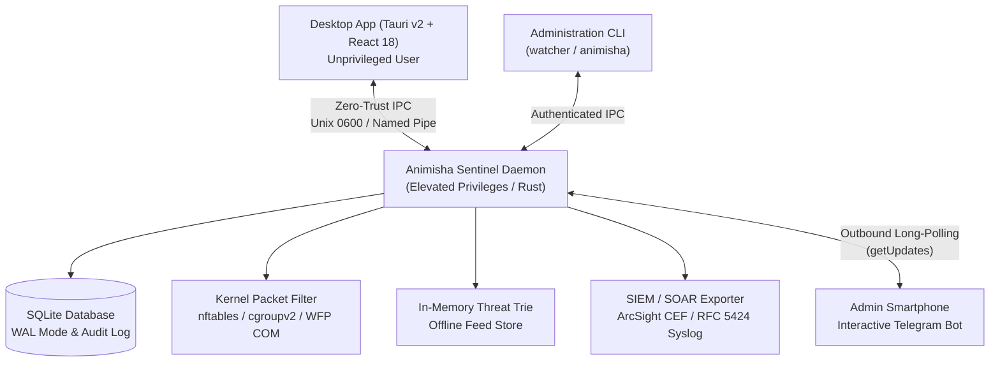

<div align="center">


# Animisha

**See every connection. Decide what gets through.**

A local-first endpoint firewall, behavioral detection engine, and live network monitor for Windows and Linux.
It attributes every connection to its owning process, validates cryptographic signatures, maps activity to MITRE ATT&CK, and enforces deterministic rules with zero cloud dependency.

[](../../releases/latest)
[](#install)
[](https://www.rust-lang.org/)
[](https://tauri.app/)

[**Download**](../../releases/latest) · [Features](#features) · [Install](#install) · [Rule engine](#the-rule-engine) · [Interactive Telegram SecOps](#interactive-telegram-secops) · [CLI commands](#cli-commands)

</div>

---

## Why Animisha

The built-in operating system firewall tells you a rule exists. It does not tell you which program is talking, whether that program is authentic, what parent process spawned it, or why a connection was allowed. Commercial EDR tools attempt to answer those questions, but they require expensive subscriptions and transmit your proprietary connection telemetry to third-party cloud servers.

Animisha answers them directly on your machine.

---

## Features

| Capability | What Animisha Does |
|---|---|
| **Process attribution & Lineage** | Every socket is tied to its owning process. Animisha inspects parent process lineage (PPID), checks digital signatures (WinVerifyTrust), computes SHA-256 binary digests, and records start times so recycled PIDs can never inherit trust. |
| **Kernel socket telemetry** | Direct Netlink `INET_DIAG` binary kernel socket tables on Linux (bypassing `/proc` latency) and native Win32 IP Helper & ETW sessions on Windows. |
| **8-tier deterministic rule engine** | Rules evaluate strictly from Emergency Lockdown down to the default fallback policy. The first matching tier wins. An explicit user block always overrides an allow rule. |
| **Behavioral Zero-Day Detection** | Real-time heuristic detection of zero-days and Living-off-the-Land Binaries (LOLBins), statistical C2 periodic beaconing timing analysis, domain Shannon entropy (DGA), process lineage exploits, and volatile path dropper egress. |
| **Developer-First Safe-Harbor** | Zero false alarms on local development tools. Localhost loopback IPC (-50 discount), Docker, Redis, Vite, Node, Antigravity AI, and build artifacts in `/tmp` receive 0 penalty for local testing. |
| **Mathematical Severity Floor** | Heuristic environmental noise is mathematically capped at 35 (`Medium`), guaranteeing that developer software and everyday apps never reach High/Critical or trigger autonomous blocks without an IOC or Behavioral IOA. |
| **MITRE ATT&CK taxonomy** | All security alerts automatically correlate to standard MITRE techniques (`T1203`, `T1190`, `T1071`, `T1568.002`, `T1036`, `T1105`, `T1059.001`, `T1059.004`, `T1218`, `T1571`). |
| **cgroupv2 process firewalling** | Linux process hierarchy isolation under `/sys/fs/cgroup/animisha/apps/<id>` with nftables `socket cgroupv2` kernel packet tagging. |
| **Offline threat intelligence** | Ingest CSV, JSON, and TXT feeds into an in-memory lock-free Radix/Trie index supporting up to 500,000 active threat indicators with zero cloud lookups. |
| **Interactive Telegram SecOps** | Receive instant mobile alerts with **1-tap action buttons** (`[Block IP]`, `[Quarantine]`, `[Investigate]`, `[Kill]`, `[Isolate Host]`) and remote chat commands. Zero inbound ports needed. |
| **Live Network Topology & Stress Lab** | Interactive SVG network map mapping Application $\rightarrow$ Defense Core $\rightarrow$ Remote Destination, with a built-in Stress Lab capable of rendering 10,000+ active connections at 60 FPS (0.15ms latency). |
| **One-Click Remediation** | One-click trust buttons in the Security Alert Inspector to immediately create permanent allow rules or switch Wi-Fi profiles (`Home`, `Work`, `Public Wi-Fi`). |
| **SIEM / SOAR streaming** | Asynchronous streaming in ArcSight CEF (Common Event Format) and RFC 5424 Syslog format over UDP and TCP. |
| **Central fleet management** | Periodic telemetry heartbeats, dynamic policy synchronization, and emergency host kill-switch isolation. |
| **Fail-closed persistence** | Kernel packet filtering rules remain active across service restarts rather than failing open. |

---

## Install

Grab the installer for your system from the **[latest release](../../releases/latest)**.

### Windows 10 / 11 (64-bit)

1. Download `animisha-v0.3.0-x64.msi`.
2. Run it as administrator. It installs the background service (`LocalSystem`), registers automatic recovery on failure, bundles `WebView2Loader.dll`, and deploys desktop shortcuts.
3. Open **Animisha** from the Start menu.

### Debian, Ubuntu and derivatives (64-bit, systemd)

```bash
sudo apt install ./animisha_0.3.0_amd64.deb
```

The package automatically configures the `systemd` service (`watcher.service`), `/usr/bin/watcher` CLI, and `/usr/share/applications/animisha.desktop` GUI.

```bash
watcher status          # check the background service
```

Launch **Animisha** from your application menu or terminal (`animisha-desktop`).

### Checksums

Each release includes `SHA256SUMS.txt` for cryptographic verification:

```bash
sha256sum -c SHA256SUMS.txt
```

On Windows PowerShell:

```powershell
Get-FileHash .\animisha-v0.3.0-x64.msi -Algorithm SHA256
```

| File | SHA-256 Checksum |
|---|---|
| `animisha-v0.3.0-x64.msi` | `3659417535fbfbab36071c50b92d3d1f22f9bf04723e08bb5b0dfec77787a09c` |
| `animisha_0.3.0_amd64.deb` | `ac4812fc2f57979e7574af082ac68dcd74dd975ba94bea3a50c5027c3a3815da` |

---

## The Rule Engine

Rules evaluate strictly from tier 1 down. The first tier with a matching rule decides the packet's fate; lower tiers are never consulted. Policy resolution is deterministic and independent of the order rules were created.

| Tier | Precedence Level | What it does |
|:-:|---|---|
| 1 | **Emergency Lockdown** | Total isolation across all network adapters. Overrides everything. |
| 2 | **Explicit User Block** | Highest-precedence custom blocks for remote IPs, subnets, ports, or protocols. |
| 3 | **Explicit User Allow** | Whitelisted applications or trusted remote destinations overriding profile defaults. |
| 4 | **Temporary Rules (TTL)** | Time-limited rules created from interactive prompts. Automatically purged on expiry. |
| 5 | **Application Rules** | Per-binary constraints tied to executable paths, cgroupv2, and digital signature status. |
| 6 | **Network Rules** | Subnet policies such as `192.168.1.0/24` or CIDR ranges. |
| 7 | **Profile Rules** | Environmental policies for the active profile: Home, Work, or Public Wi-Fi. |
| 8 | **Default Fallback Policy** | Baseline default action: block all unauthorized inbound, permit outbound. |

---

## Zero-Day Behavioral Detection Engine

Unlike traditional firewalls that rely solely on static IP blocklists (which are blind to novel attacks and zero-days), Animisha integrates **5 behavioral Indicators of Attack (IOA) engines** that detect malicious activity mathematically without cloud dependency:

| Component | MITRE ATT&CK | How It Works | Developer Safe-Harbor |
|---|:---:|---|---|
| **1. Process Lineage Analyzer** | `T1203`<br/>`T1190` | Detects when web browsers (Firefox, Chrome), productivity apps, or server daemons (Redis, Nginx) spawn unauthorized command interpreters (`sh`, `bash`, `cmd.exe`, `powershell`). | Shells and curl/wget spawned by terminal emulators, IDEs (VS Code, Cursor, Antigravity AI), and CI build agents are explicitly permitted. |
| **2. Statistical C2 Beaconing Timing Analysis** | `T1071` | Tracks rolling timestamp intervals ($\Delta t$) per `(PID, RemoteIP, RemotePort)` tuple. Calculates variance ($\sigma^2$) and coefficient of variation ($\text{CV} = \sigma / \mu$). Periodic heartbeats ($\text{CV} \le 0.15$, $\Delta t \ge 5\text{s}$) escalate directly to High/Critical. | Media streaming ($\Delta t < 2\text{s}$) and human web browsing ($\text{CV} > 0.40$) are ignored; browser HTTPS egress on standard ports is exempt. |
| **3. Domain Shannon Entropy (DGA Engine)** | `T1568.002` | Measures information entropy $H(X) = -\sum P(x) \log_2 P(x)$ across DNS domain labels. High-entropy pseudo-random domains ($\ge 3.5$ on suspicious TLDs or $\ge 4.0$ on any TLD) trigger active C2 alerts. | Legitimate developer registries (`crates.io`, `github.com`) and cloud CDN hashes (`*.cloudfront.net`, `*.azureedge.net`, `*.cloudflare.com`) are whitelisted. |
| **4. Volatile Dropper Egress Correlation** | `T1036`<br/>`T1105` | Correlates execution from volatile user-writable scratch paths (`/tmp`, `/dev/shm`, `AppData\Local\Temp`) with outbound public WAN communication on high/non-standard ports. | Local dev test builds and automated test runners communicating strictly over `127.0.0.1` or private LAN receive **0 penalty**. |
| **5. Severity Floor Gate** | N/A | Cumulative environmental heuristic noise is mathematically capped at **35 (`Medium`)**. An alert can never escalate to High or Critical or trigger an automated block unless backed by a verified Threat Intel IOC or a verified Behavioral IOA. | Guarantees that everyday tools (Docker, Redis, Node/Vite, Antigravity AI, Python) never produce disruptive false alarms. |

---

## How It Works

A privileged background service performs all sensitive socket tracking and firewall operations. The desktop user interface runs as an ordinary, unprivileged user communicating over authenticated zero-trust local IPC.



- **Zero-Trust Local IPC**: Communication between user interfaces and the daemon uses restricted Unix domain sockets (`/var/run/watcher/watcher.sock`, mode `0600`) or Windows Named Pipes with strict DACLs, authenticated via 256-bit CSPRNG tokens with constant-time verification.
- **Fail-Closed Persistence**: Rules stay active in the kernel packet filter across service restarts.
- **Namespaced Rule Protection**: Rules are namespaced under `Watcher.Rule.*` so third-party or OS rules are never modified.

---

## Interactive Telegram SecOps

Animisha includes a bidirectional incident response bot. When suspicious connections, LOLBin invocations, or threat feed hits are detected, a rich alert arrives on your phone with **1-tap response buttons**:

```text
🛡️ ANIMISHA SECURITY INCIDENT ALERT
━━━━━━━━━━━━━━━━━━━━━━━━━━━
🚨 [CRITICAL] Suspicious Outbound Connection: powershell.exe

🖥️ Process: powershell.exe (PID: 4892)
🌐 Destination: 198.51.100.45:4444
📊 Risk Score: 95 / 100
🔍 Forensic Evidence:
  • Living-off-the-land utility 'powershell.exe' executed encoded command stager
  • MITRE ATT&CK: Command and Scripting Interpreter (T1059.001)

[ 🛑 Block IP 198.51.100.45 ]   [ 🔒 Quarantine PID 4892 ]
[ 🔍 Investigate ]  [ 💀 Kill ]  [ 🌐 Isolate Host ]
```

### Mobile Actions & Commands
* **`[ 🛑 Block IP ]`**: Instantly injects an explicit kernel/firewall `BLOCK` rule for the remote IP.
* **`[ 🔒 Quarantine PID ]`**: Freezes the process and adds the application to the quarantine list.
* **`[ 🔍 Investigate ]`**: Generates a deep forensic dossier (cmdline, parent process, Authenticode signature, SHA-256, active sockets) and replies in chat.
* **`[ 💀 Kill ]`**: Dispatches an immediate process termination signal.
* **`[ 🌐 Isolate Host ]`**: Engages the endpoint network kill-switch, cutting all non-essential ingress/egress.
* **Chat Commands**: `/status`, `/investigate <PID or IP>`, `/block <IP>`, `/unblock <IP>`, `/quarantine <PID>`, `/kill <PID>`, `/isolate on|off`, `/rules`, `/help`.

> [!TIP]
> **No Open Inbound Ports Required**: The bot communicates via outbound HTTPS long-polling (`getUpdates`). It works behind NAT, VPNs, home routers, and corporate firewalls without opening any ports. Incoming interactions are restricted to your configured administrator user ID.

---

## CLI Commands

The `watcher` (or alias `animisha`) CLI provides command-line control:

```bash
# Core status and diagnostics
watcher status
watcher inspect <PID or Path>            # Authenticode, SHA-256, parent process

# Rule management and live verification
watcher rules list
watcher rules verify                     # Reconcile rules against OS kernel
watcher rules add --name "Block C2" --action block --dest-ip 198.51.100.99
watcher rules delete <RULE_ID>

# Threat intelligence feeds
watcher threats summary
watcher threats feeds
watcher threats import --path "blocklist.csv" --format csv --name "OTX AlienVault"

# SIEM / SOAR export
watcher siem status
watcher siem test                        # Send sample alert over UDP/TCP
watcher siem export --format cef --output /var/log/watcher_cef.log

# Central fleet management & remote isolation
watcher fleet status
watcher fleet sync                       # Synchronize policies from central server
watcher fleet isolate --enable           # Engage remote network lockdown
watcher fleet isolate --disable          # Restore normal connectivity

# Interactive Telegram alert probe
watcher alert test-telegram

# Emergency Lockdown
watcher lockdown
watcher unlock
```

---

## Configuration

Default settings (`/etc/watcher/watcher.toml` on Linux, `C:\ProgramData\Watcher\watcher.toml` on Windows):

```toml
[service]
port_or_pipe = "127.0.0.1:59100"

[firewall]
default_inbound = "block"
default_outbound = "allow"
enable_auto_rollback = true
rollback_timeout_seconds = 30
allow_loopback = true

[telemetry]
poll_interval_ms = 1000
max_connections_in_memory = 10000

[telegram]
enabled = false
bot_token = ""
chat_id = ""
min_severity = "High"

[siem]
enabled = false
format = "cef"          # "cef" or "syslog"
transport = "udp"       # "udp" or "tcp"
host = "127.0.0.1"
port = 514

[database]
path = "/var/lib/watcher/watcher.db"
connection_retention_days = 30
alert_retention_days = 90
event_retention_days = 60
```

---

## Security

Animisha is an endpoint security system. If you discover a vulnerability, please report it responsibly via the repository's **Security** tab using **Report a vulnerability**.

## Source Code

The source code is maintained privately. Release binaries and installers are published with cryptographic SHA-256 checksums to verify every build.

Found an issue or have a feature request? [Open an issue](../../issues).

---

<div align="center">
<sub>Built with precision by Khemendra Singh Khangarot</sub>
</div>
