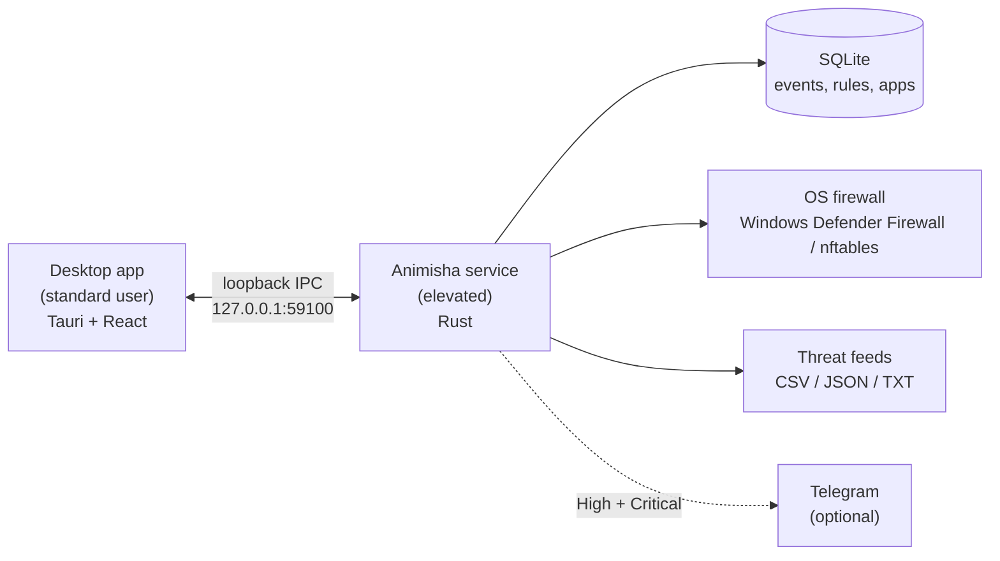

<div align="center">


# Animisha

**See every connection. Decide what gets through.**

A local-first endpoint firewall and network monitor for Windows and Linux.
It shows which program owns each connection, checks whether that program is signed, and enforces your rules in a fixed, predictable order. No cloud account. No telemetry.

[](../../releases/latest)
[](#install)
[](https://www.rust-lang.org/)
[](https://tauri.app/)

[**Download**](../../releases/latest) · [Features](#features) · [Install](#install) · [Rule engine](#the-rule-engine) · [Telegram alerts](#telegram-alerts)

</div>

---

## Why Animisha

The built-in firewall tells you a rule exists. It does not tell you which program is talking, whether that program is trustworthy, or why a connection was allowed. Commercial EDR tools answer those questions, but they cost money and send your connection data to someone else's cloud.

Animisha answers them on your own machine.

## Features

| | |
|---|---|
| **Process attribution** | Every socket is tied to its owning process. Animisha checks the digital signature, computes a SHA-256 of the binary and records the process start time, so a recycled PID can never inherit trust from the program that used it before. |
| **8-tier rule engine** | Rules are evaluated from Emergency Lockdown down to the default policy, and the first match wins. A block you wrote always beats an allow you wrote. |
| **Offline threat intelligence** | Import CSV, JSON or TXT blocklists. Lookups run against an in-memory index, with up to 500,000 indicators loaded. |
| **Network profiles** | Home, Work and Public Wi-Fi profiles switch automatically when you join a known Wi-Fi network. |
| **Emergency Lockdown** | One switch isolates every adapter and overrides all allow rules until you turn it off. |
| **Telegram alerts** | High and Critical alerts are sent to your own Telegram chat, with the evidence. Off by default. |
| **Investigation tools** | Live traffic, a process-to-host network map, a process tree and a chronological security timeline. |
| **Private by design** | Monitoring, rules, signature checks and threat-feed lookups all run locally. |

## Install

Grab the installer for your system from the **[latest release](../../releases/latest)**.

### Windows 10 / 11 (64-bit)

1. Download `animisha-v0.3.0-x64.msi`.
2. Run it as administrator. It registers the background service and sets it to recover automatically if it stops.
3. Open **Animisha** from the Start menu.

### Debian, Ubuntu and derivatives (64-bit, systemd)

```bash
sudo apt install ./animisha_0.3.0_amd64.deb
```

The package depends on `nftables`, `systemd` and the GTK and WebKit libraries used by the desktop app. The service starts on its own and runs at boot.

```bash
animisha status          # check the service
```

Then launch **Animisha** from your application menu.

### Verify your download

Each release includes `SHA256SUMS.txt`.

```bash
sha256sum -c SHA256SUMS.txt
```

On Windows PowerShell:

```powershell
Get-FileHash .\animisha-v0.3.0-x64.msi -Algorithm SHA256
```

| File | SHA-256 |
|---|---|
| `animisha-v0.3.0-x64.msi` | `6f718ef87d45fb869216792a354da3e0cd249f2ef0c64407ccad1a449b23842d` |
| `animisha_0.3.0_amd64.deb` | `834a49e798faf0421cea43fe5c3ab322ba1b12e97f0b91e31249cc66bfd81feb` |

## The rule engine

Rules are checked from tier 1 down. The first tier with a matching rule decides, and lower tiers are never consulted. Nothing depends on the order you created your rules in.

| Tier | Level | What it does |
|:-:|---|---|
| 1 | **Emergency Lockdown** | Total isolation across all adapters. Overrides everything. |
| 2 | **Explicit User Block** | Your block rules for addresses, ports or protocols. |
| 3 | **Explicit User Allow** | Your allow rules for trusted programs or destinations. |
| 4 | **Temporary Rules** | Time-limited rules from interactive prompts. They delete themselves on expiry. |
| 5 | **Application Rules** | Per-binary rules tied to the path and signature status. |
| 6 | **Network Rules** | Subnet policies such as `192.168.1.0/24`. |
| 7 | **Profile Rules** | Rules for the active profile: Home, Work or Public Wi-Fi. |
| 8 | **Default Policy** | The fallback, usually block inbound and allow outbound. |

## How it works

A privileged background service does the sensitive work. The desktop app runs as an ordinary user and can only ask the service questions over a local connection.



- The desktop app never has administrator rights, and the service accepts connections from the local machine only.
- On Windows, Animisha manages rules through Windows Defender Firewall and keeps them under its own name, so it never edits rules it did not create.
- State is stored in SQLite.

## Telegram alerts

Telegram alerting is **off by default**. To turn it on, create a bot with [@BotFather](https://t.me/BotFather), then add your token and chat ID in **Settings**, or in the config file.

On Linux the file is `/etc/watcher/watcher.toml`:

```toml
[telegram]
enabled = true
bot_token = "YOUR_TELEGRAM_BOT_TOKEN"
chat_id = "YOUR_TELEGRAM_CHAT_ID"
min_severity = "High"
```

Only the text of the alert is sent, and only to the chat you configure.

## Configuration

Default settings on Linux (`/etc/watcher/watcher.toml`):

```toml
[service]
port_or_pipe = "127.0.0.1:59100"

[firewall]
default_inbound = "block"
default_outbound = "allow"
enable_auto_rollback = true
rollback_timeout_seconds = 30
allow_loopback = true

[telemetry]
poll_interval_ms = 1000
max_connections_in_memory = 10000

[database]
path = "/var/lib/watcher/watcher.db"
connection_retention_days = 30
alert_retention_days = 90
event_retention_days = 60
```

## Known limitations

- **Polling interval.** Sockets are checked once a second, so a connection that opens and closes within a few milliseconds between checks can be missed.
- **Threat index size.** The in-memory index is capped at 500,000 indicators by default.
- **Very high traffic.** Behaviour above 100,000 packets per second has not been tested.

## Roadmap

- [ ] Windows Filtering Platform kernel driver for inline packet filtering, removing the polling delay
- [ ] On-device anomaly detection for unusual connection bursts and beaconing
- [ ] More Linux distributions and package formats

## Security

Animisha is a security tool, so please report vulnerabilities privately instead of opening a public issue. Use the repository's **Security** tab, then **Report a vulnerability**.

## Source code

The source code is private. Releases are published here as installers with SHA-256 checksums so you can verify every download.

Found a bug or have an idea? [Open an issue](../../issues).

---

<div align="center">
<sub>Built by Khemendra Singh Khangarot</sub>
</div>
