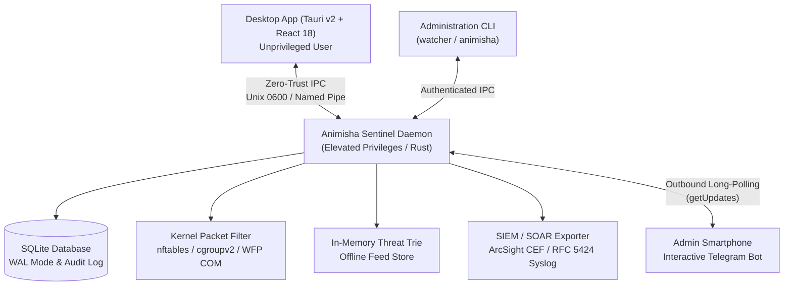

# ANIMISHA
<div align="center">

**Next-Generation Endpoint Detection and Response (EDR) & Process-Aware Firewall**


[](https://www.rust-lang.org)
[](https://tauri.app)
[](https://react.dev)
[]()
[](LICENSE)
[]()
# Animisha

**ANIMISHA** (Sanskrit: *अनिमिष* — *"The Ever-Vigilant Sentinel Who Never Blinks"*, developed under the project names *WATCHER* and *AEGIS Firewall*) is an enterprise-grade, process-aware endpoint security firewall, behavioral detection engine, and live network intelligence platform for **Linux and Windows**. Engineered with strict privilege separation, ANIMISHA pairs an elevated kernel/system background daemon with an unprivileged desktop control center (Tauri v2 + React 18 + TypeScript), a unified CLI, and an interactive **mobile Telegram SecOps bot** to deliver microsecond-level visibility, forensic inspection, MITRE ATT&CK mapping, and deterministic rule enforcement.
**See every connection. Decide what gets through.**

> [!IMPORTANT]
> **Zero Simulation Policy**: ANIMISHA interacts directly with live operating system kernel networking stacks (Linux `nftables` / `cgroupv2` / Netlink `INET_DIAG`, Windows Filtering Platform / COM `INetFwPolicy2`) and native OS APIs. It never displays simulated, synthetic, or mock telemetry.
A local-first endpoint firewall, behavioral detection engine, and live network monitor for Windows and Linux.
It attributes every connection to its owning process, validates cryptographic signatures, maps activity to MITRE ATT&CK, and enforces deterministic rules with zero cloud dependency.

[](../../releases/latest)
[](#install)
[](https://www.rust-lang.org/)
[](https://tauri.app/)

[**Download**](../../releases/latest) · [Features](#features) · [Install](#install) · [Rule engine](#the-rule-engine) · [Interactive Telegram SecOps](#interactive-telegram-secops) · [CLI commands](#cli-commands)

</div>

---

## 🏛️ System Architecture
## Why Animisha

```text
       ┌─────────────────────────────────────────────────────────────┐
       │   ANIMISHA Desktop GUI (Tauri v2 / React 18)                │
       │   CLI (`watcher` / `animisha`)  │  Mobile Telegram Bot      │
       └──────────────┬───────────────────────────┬──────────────────┘
                      │                           │
          Zero-Trust IPC Socket           Outbound Long-Polling
          (Unix 0600 / Named Pipe)        (Telegram getUpdates)
                      │                           │
                      ▼                           ▼
       ┌─────────────────────────────────────────────────────────────┐
       │            ANIMISHA Sentinel Daemon (Rust)                  │
       ├──────────────────────────┬──────────────────────────────────┤
       │ Telemetry & Kernel Layer │ Enforcement & Isolation Layer    │
       │  • Netlink INET_DIAG     │  • nftables / WFP COM Fast-Path  │
       │  • eBPF Socket Buffer    │  • cgroupv2 Hierarchy Isolator   │
       │  • Windows ETW & IP Helper│ • Fail-Closed State Watchdog    │
       ├──────────────────────────┼──────────────────────────────────┤
       │ Behavioral Engine        │ Enterprise Integrations          │
       │  • MITRE ATT&CK Engine   │  • ArcSight CEF & RFC 5424 Syslog│
       │  • LOLBin Detection      │  • Central Fleet Sync & Isolation│
       │  • PPID Lineage & Cmdline│  • Asynchronous SIEM Forwarder   │
       │  • Dev Baseline Profiler │  • Offline Threat Feed Trie      │
       └──────────────────────────┴──────────────────────────────────┘
The built-in operating system firewall tells you a rule exists. It does not tell you which program is talking, whether that program is authentic, what parent process spawned it, or why a connection was allowed. Commercial EDR tools attempt to answer those questions, but they require expensive subscriptions and transmit your proprietary connection telemetry to third-party cloud servers.

Animisha answers them directly on your machine.

---

## Features

| Capability | What Animisha Does |
|---|---|
| **Process attribution & Lineage** | Every socket is tied to its owning process. Animisha inspects parent process lineage (PPID), checks digital signatures (WinVerifyTrust), computes SHA-256 binary digests, and records start times so recycled PIDs can never inherit trust. |
| **Kernel socket telemetry** | Direct Netlink `INET_DIAG` binary kernel socket tables on Linux (bypassing `/proc` latency) and native Win32 IP Helper & ETW sessions on Windows. |
| **8-tier deterministic rule engine** | Rules evaluate strictly from Emergency Lockdown down to the default fallback policy. The first matching tier wins. An explicit user block always overrides an allow rule. |
| **Behavioral engine & LOLBins** | Real-time heuristic detection of Living-off-the-Land Binaries (PowerShell Base64 stagers, CertUtil ingress, BITSAdmin, MSHTA, Rundll32 scriptlets, Unix `/dev/tcp` reverse shells, Netcat execution flags). |
| **MITRE ATT&CK taxonomy** | All security alerts automatically correlate to standard MITRE techniques (`T1059.001`, `T1059.004`, `T1105`, `T1218`, `T1036`, `T1071.001`, `T1048`, `T1571`). |
| **cgroupv2 process firewalling** | Linux process hierarchy isolation under `/sys/fs/cgroup/animisha/apps/<id>` with nftables `socket cgroupv2` kernel packet tagging. |
| **Offline threat intelligence** | Ingest CSV, JSON, and TXT feeds into an in-memory Trie index supporting up to 500,000 active threat indicators with zero cloud lookups. |
| **Interactive Telegram SecOps** | Receive instant mobile alerts with **1-tap action buttons** (`[Block IP]`, `[Quarantine]`, `[Investigate]`, `[Kill]`, `[Isolate Host]`) and remote chat commands. Zero inbound ports needed. |
| **SIEM / SOAR streaming** | Asynchronous streaming in ArcSight CEF (Common Event Format) and RFC 5424 Syslog format over UDP and TCP. |
| **Central fleet management** | Periodic telemetry heartbeats, dynamic policy synchronization, and emergency host kill-switch isolation. |
| **Network profiles** | Home, Work, and Public Wi-Fi profiles switch automatically when joining recognized Wi-Fi SSIDs. |
| **Fail-closed persistence** | Kernel packet filtering rules remain active across service restarts rather than failing open. |

---

## Install

Grab the installer for your system from the **[latest release](../../releases/latest)**.

### Windows 10 / 11 (64-bit)

1. Download `animisha-v0.3.0-x64.msi`.
2. Run it as administrator. It installs the background service (`LocalSystem`), registers automatic recovery on failure, bundles `WebView2Loader.dll`, and deploys desktop shortcuts.
3. Open **Animisha** from the Start menu.

### Debian, Ubuntu and derivatives (64-bit, systemd)

```bash
sudo apt install ./animisha_0.3.0_amd64.deb
```

### Authoritative Architecture
* **Privileged Background Daemon (`watcher-service` / `animisha-service`)**: Executes as a privileged service (`root` on Linux via systemd, `LocalSystem` on Windows) managing the authoritative SQLite database, kernel Netlink socket tables, cgroupv2 process hierarchy, LOLBin behavioral heuristics, differential topology streaming, and live OS firewall rules.
* **Desktop Control Center (`animisha-desktop` / `watcher-desktop`)**: Unprivileged user-session GUI communicating with the service over authenticated zero-trust IPC. Both standard user sessions and elevated admin sessions query the same authoritative service daemon.
* **Administration CLI (`watcher` / `animisha`)**: Complete command-line management client providing access to daemon status, network profiles, live sockets, rules verification, process forensics, SIEM streaming controls, and fleet management.
* **Interactive Mobile SecOps Bot (Telegram)**: Enables administrators to receive instant critical push alerts and perform 1-tap incident response (blocking IPs, quarantining processes, forensic investigation, network isolation) directly from their smartphone.
The package automatically configures the `systemd` service (`watcher.service`), `/usr/bin/watcher` CLI, and `/usr/share/applications/animisha.desktop` GUI.

```bash
watcher status          # check the background service
```

Launch **Animisha** from your application menu or terminal (`animisha-desktop`).

### Checksums

Each release includes `SHA256SUMS.txt` for cryptographic verification:

```bash
sha256sum -c SHA256SUMS.txt
```

On Windows PowerShell:

```powershell
Get-FileHash .\animisha-v0.3.0-x64.msi -Algorithm SHA256
```

| File | SHA-256 Checksum |
|---|---|
| `animisha-v0.3.0-x64.msi` | `6f718ef87d45fb869216792a354da3e0cd249f2ef0c64407ccad1a449b23842d` |
| `animisha_0.3.0_amd64.deb` | `dfd3cf1e8f7c3754243bce2dcef9959fe9306f8362cb05a835b6c2e800a7ac67` |

---

## 🚀 Key Enterprise Capabilities
## The Rule Engine

### 1. 🛡️ Kernel Telemetry & Real-Time Enforcement
* **Netlink `INET_DIAG` Socket Diagnostics**: Directly reads the Linux binary kernel socket table, bypassing `/proc/net/tcp` for microsecond-latency socket sweeps.
* **eBPF & Windows ETW Telemetry**: eBPF connection tracking buffer on Linux and `Microsoft-Windows-Kernel-Network` ETW provider session on Windows.
* **cgroupv2 Process Firewalling**: Dynamically organizes applications under `/sys/fs/cgroup/animisha/apps/<id>` and enforces firewall filtering via nftables `socket cgroupv2 level 2` rules.
* **Fail-Closed Architecture**: Operating system firewall rules remain persistent and active in the kernel stack even across daemon restarts or unexpected terminations.
Rules evaluate strictly from tier 1 down. The first tier with a matching rule decides the packet's fate; lower tiers are never consulted. Policy resolution is deterministic and independent of the order rules were created.

### 2. 🧠 Advanced Behavioral Engine & Threat Hunting
* **Parent Process Lineage (PPID) & Command-Line Inspection**: Inspects the entire process traversal tree and command-line arguments across Linux `/proc` and Windows Toolhelp32 snapshots.
* **MITRE ATT&CK Mapping**: Every security alert maps to industry-standard techniques:
  * `T1059.001` (PowerShell Encoded Commands)
  * `T1059.004` (Unix Shell Reverse Sockets)
  * `T1105` (Ingress Tool Transfer — CertUtil, BITSAdmin, Curl/Wget pipe-to-shell)
  * `T1218` (System Binary Proxy Execution — MSHTA, Rundll32, Regsvr32)
  * `T1036` (Process Masquerading)
  * `T1071.001` (C2 Web Protocols)
  * `T1048` (Exfiltration Over Alternative Protocol)
  * `T1571` (Non-Standard Ports)
* **Living-Off-The-Land (LOLBin) Detection**: Real-time heuristic detection of dual-use binaries abused for payload staging, code execution, or reverse shells.
* **Developer Baseline Profiling**: Automatically suppresses false-positive noise from recognized developer toolchains (Cargo, npm, git) with strict **zero-tolerance inhibition** against verified threat indicators or offensive ports.
| Tier | Precedence Level | What it does |
|:-:|---|---|
| 1 | **Emergency Lockdown** | Total isolation across all network adapters. Overrides everything. |
| 2 | **Explicit User Block** | Highest-precedence custom blocks for remote IPs, subnets, ports, or protocols. |
| 3 | **Explicit User Allow** | Whitelisted applications or trusted remote destinations overriding profile defaults. |
| 4 | **Temporary Rules (TTL)** | Time-limited rules created from interactive prompts. Automatically purged on expiry. |
| 5 | **Application Rules** | Per-binary constraints tied to executable paths, cgroupv2, and digital signature status. |
| 6 | **Network Rules** | Subnet policies such as `192.168.1.0/24` or CIDR ranges. |
| 7 | **Profile Rules** | Environmental policies for the active profile: Home, Work, or Public Wi-Fi. |
| 8 | **Default Fallback Policy** | Baseline default action: block all unauthorized inbound, permit outbound. |

### 3. 📱 Bidirectional Telegram SecOps Bot (Mobile Incident Response)
* **1-Tap Inline Alert Buttons**: Tapping buttons directly on alert notifications executes immediate mitigation:
  * `[ 🛑 Block IP ]` — Injects an immediate firewall block rule.
  * `[ 🔒 Quarantine PID ]` — Freezes and isolates the suspect process.
  * `[ 🔍 Investigate ]` — Compiles and replies with a deep forensic dossier (cmdline, parent PID, digital signature, SHA-256, active sockets).
  * `[ 💀 Kill ]` — Forcefully terminates malicious processes.
  * `[ 🌐 Isolate Host ]` — Engages the emergency network kill-switch.
* **Mobile Slash Commands**: `/status`, `/investigate <PID or IP>`, `/block <IP>`, `/unblock <IP>`, `/quarantine <PID>`, `/kill <PID>`, `/isolate on|off`, `/rules`, `/help`.
* **Zero Inbound Ports**: Employs outbound HTTPS long-polling (`getUpdates`). Works seamlessly behind NAT, home routers, and corporate proxies.
* **Zero-Trust Access Control**: Enforces strict user ID whitelisting against your configured administrator chat ID.
---

### 4. 🏢 SIEM / SOAR & Central Fleet Management
* **ArcSight CEF & RFC 5424 Syslog Exporters**: Standards-compliant security log streaming over UDP and TCP.
* **Central Fleet Management**: Dispatches periodic telemetry heartbeats and synchronizes security policies from central management consoles.
* **Remote Host Isolation**: One-click and remote kill-switch network lockdown isolating compromised hosts while preserving remote administrative channels.
## How It Works

A privileged background service performs all sensitive socket tracking and firewall operations. The desktop user interface runs as an ordinary, unprivileged user communicating over authenticated zero-trust local IPC.



- **Zero-Trust Local IPC**: Communication between user interfaces and the daemon uses restricted Unix domain sockets (`/var/run/watcher/watcher.sock`, mode `0600`) or Windows Named Pipes with strict DACLs, authenticated via 256-bit CSPRNG tokens with constant-time verification.
- **Fail-Closed Persistence**: Rules stay active in the kernel packet filter across service restarts.
- **Namespaced Rule Protection**: Rules are namespaced under `Watcher.Rule.*` so third-party or OS rules are never modified.

---

## ⚡ 8-Tier Rule Precedence Engine
## Interactive Telegram SecOps

All network traffic evaluations follow a deterministic conflict-free hierarchy:
Animisha includes a bidirectional incident response bot. When suspicious connections, LOLBin invocations, or threat feed hits are detected, a rich alert arrives on your phone with **1-tap response buttons**:

| Tier | Precedence Level | Description |
| :---: | :--- | :--- |
| **1** | **Emergency Lockdown** | Total inbound and outbound isolation across all network adapters. |
| **2** | **Explicit User Block** | Administrator-defined block rules with highest priority. |
| **3** | **Explicit User Allow** | Administrator-defined allow rules overriding profile defaults. |
| **4** | **Temporary Rules (TTL)** | Time-limited rules with automatic background expiration and rollback. |
| **5** | **Application Rules** | Process path, cgroupv2, and digital signature constraints. |
| **6** | **Network Rules** | CIDR prefixes, IP addresses, port ranges, and protocols. |
| **7** | **Profile Rules** | Dynamic environmental policies (`Home`, `Work`, `Public Wi-Fi`, `Lockdown`). |
| **8** | **Default Policy Fallback** | Safe baseline default action (Block Inbound / Allow Outbound). |
```text
🛡️ ANIMISHA SECURITY INCIDENT ALERT
━━━━━━━━━━━━━━━━━━━━━━━━━━━
🚨 [CRITICAL] Suspicious Outbound Connection: powershell.exe

🖥️ Process: powershell.exe (PID: 4892)
🌐 Destination: 198.51.100.45:4444
📊 Risk Score: 95 / 100
🔍 Forensic Evidence:
  • Living-off-the-land utility 'powershell.exe' executed encoded command stager
  • MITRE ATT&CK: Command and Scripting Interpreter (T1059.001)

[ 🛑 Block IP 198.51.100.45 ]   [ 🔒 Quarantine PID 4892 ]
[ 🔍 Investigate ]  [ 💀 Kill ]  [ 🌐 Isolate Host ]
```

### Mobile Actions & Commands
* **`[ 🛑 Block IP ]`**: Instantly injects an explicit kernel/firewall `BLOCK` rule for the remote IP.
* **`[ 🔒 Quarantine PID ]`**: Freezes the process and adds the application to the quarantine list.
* **`[ 🔍 Investigate ]`**: Generates a deep forensic dossier (cmdline, parent process, Authenticode signature, SHA-256, active sockets) and replies in chat.
* **`[ 💀 Kill ]`**: Dispatches an immediate process termination signal.
* **`[ 🌐 Isolate Host ]`**: Engages the endpoint network kill-switch, cutting all non-essential ingress/egress.
* **Chat Commands**: `/status`, `/investigate <PID or IP>`, `/block <IP>`, `/unblock <IP>`, `/quarantine <PID>`, `/kill <PID>`, `/isolate on|off`, `/rules`, `/help`.

> [!TIP]
> **No Open Inbound Ports Required**: The bot communicates via outbound HTTPS long-polling (`getUpdates`). It works behind NAT, VPNs, home routers, and corporate firewalls without opening any ports. Incoming interactions are restricted to your configured administrator user ID.

---

## 💻 CLI Quick Reference
## CLI Commands

The `watcher` (or alias `animisha` / `aegis`) administration CLI communicates directly with the local daemon via zero-trust IPC:
The `watcher` (or alias `animisha`) CLI provides command-line control:

```bash
# Daemon status and active profile
# Core status and diagnostics
watcher status
watcher inspect <PID or Path>            # Authenticode, SHA-256, parent process

# Inspect binary or running process (Authenticode / SHA-256 / cmdline)
watcher inspect 1234
watcher inspect "/usr/bin/curl"

# List and verify live OS firewall rules
# Rule management and live verification
watcher rules list
watcher rules verify                     # Verify rules against live OS backend
watcher rules add --name "Block Malicious IP" --action block --dest-ip 198.51.100.99
watcher rules verify                     # Reconcile rules against OS kernel
watcher rules add --name "Block C2" --action block --dest-ip 198.51.100.99
watcher rules delete <RULE_ID>

# Threat intelligence summary, feeds, and import stats
# Threat intelligence feeds
watcher threats summary
watcher threats feeds
watcher threats stats
watcher threats import --path "blocklist.csv" --format csv --name "AlienVault OTX"
watcher threats import --path "blocklist.csv" --format csv --name "OTX AlienVault"

# Interactive Mobile Telegram alerts test
watcher alert test-telegram

# SIEM / SOAR Exporter Management
# SIEM / SOAR export
watcher siem status
watcher siem test                        # Send sample alert over UDP/TCP
watcher siem export --format cef --output /var/log/watcher_cef.log

# Central Fleet Management & Remote Isolation
# Central fleet management & remote isolation
watcher fleet status
watcher fleet sync                       # Synchronize policies from central server
watcher fleet isolate --enable           # Engage remote network lockdown
watcher fleet isolate --disable          # Restore normal connectivity

# Physical network environment and dynamic Wi-Fi profiles
watcher network status
watcher profiles list
watcher profile set Home
# Interactive Telegram alert probe
watcher alert test-telegram

# Instant Emergency Lockdown (blocks all adapters)
# Emergency Lockdown
watcher lockdown
watcher unlock
```

---

## 📦 Installation & Deployment
## Configuration

### Linux Debian / Ubuntu (`.deb` Package)
Default settings (`/etc/watcher/watcher.toml` on Linux, `C:\ProgramData\Watcher\watcher.toml` on Windows):

```bash
# 1. Install Debian package
sudo dpkg -i animisha_0.3.0_amd64.deb
```toml
[service]
port_or_pipe = "127.0.0.1:59100"

# 2. Enable and start privileged background systemd service
sudo systemctl daemon-reload
sudo systemctl enable --now watcher.service
[firewall]
default_inbound = "block"
default_outbound = "allow"
enable_auto_rollback = true
rollback_timeout_seconds = 30
allow_loopback = true

# 3. Verify daemon status
watcher status
[telemetry]
poll_interval_ms = 1000
max_connections_in_memory = 10000

# 4. Launch desktop GUI
animisha-desktop
```
[telegram]
enabled = false
bot_token = ""
chat_id = ""
min_severity = "High"

### Windows MSI Installer
[siem]
enabled = false
format = "cef"          # "cef" or "syslog"
transport = "udp"       # "udp" or "tcp"
host = "127.0.0.1"
port = 514

Download the production x64 MSI package: `ANIMISHA-v0.3.0-x64.msi` (or `WATCHER-v0.3.0-x64.msi`).
1. Double-click the MSI installer and accept the UAC administrator prompt.
2. The installer automatically installs binaries to `C:\Program Files\ANIMISHA\bin\`, bundles native `WebView2Loader.dll`, registers and starts the Windows Service under `LocalSystem`, and creates Desktop shortcuts.
3. Launch **ANIMISHA** from the Start Menu.
[database]
path = "/var/lib/watcher/watcher.db"
connection_retention_days = 30
alert_retention_days = 90
event_retention_days = 60
```

---

## 📁 Repository Structure
## Security

```text
watcher/
├── apps/
│   └── desktop/          # Tauri v2 + React 18 + TypeScript Control Center GUI
├── cli/                  # watcher / animisha / aegis command-line client (Rust)
├── crates/
│   ├── common/           # Error models, token authentication, and shared constants
│   ├── configuration/    # TOML configuration loader and path resolver
│   ├── core/             # Domain schemas, MITRE taxonomy, and CEF/Syslog encoders
│   ├── database/         # SQLite persistence, migrations, and retention cleanup
│   ├── detection/        # LOLBin detector, Trie threat index, and dev baseline profiler
│   ├── dns/              # Passive DNS cache and query analyzer
│   ├── firewall/         # nftables, cgroupv2 isolator, and Windows WFP COM fast-path
│   ├── ipc/              # Zero-trust Unix domain sockets & Windows Named Pipes
│   ├── logging/          # Structured tracing subscribers & rolling file appender
│   ├── process/          # PPID lineage, cmdline inspection, Authenticode & SHA-256
│   ├── rules/            # Deterministic 8-tier rule precedence engine
│   ├── service/          # Privileged daemon, Telegram SecOps bot, SIEM & fleet sync
│   └── telemetry/        # Netlink INET_DIAG, eBPF tracker, Windows ETW & IP Helper
├── migrations/           # SQLite schema migrations (001_initial, 002_threat_intel, 003_v030, 004_v040)
├── platform/
│   ├── linux/            # systemd unit, debian package control, and nftables scripts
│   └── windows/          # Windows SCM Service and WFP COM helpers
└── docs/                 # Architectural specifications, RFC mappings, and QA reports
```
Animisha is an endpoint security system. If you discover a vulnerability, please report it responsibly via the repository's **Security** tab using **Report a vulnerability**.

---
## Source Code

## 🔒 Security Model
The source code is maintained privately. Release binaries and installers are published with cryptographic SHA-256 checksums to verify every build.

* **Privilege Separation**: Unprivileged React/Tauri UI communicates over restricted zero-trust local IPC (Unix Domain Socket `0600` / Windows Named Pipe) with the elevated daemon.
* **Cryptographic Token Authentication**: IPC requests are verified with 256-bit CSPRNG tokens using constant-time comparison (`verify_token_constant_time`).
* **Authoritative Persistence**: All rule modifications, quarantine states, and threat indicators are validated and committed by the service daemon to prevent split-brain states.
* **Non-Destructive Namespacing**: Firewall operations are scoped to avoid overriding baseline system or corporate policies.
* **Offline-First Resilience**: All core threat evaluation, behavioral detection, and firewall enforcement runs completely locally on the endpoint without cloud dependencies.
Found an issue or have a feature request? [Open an issue](../../issues).

---

## 📄 License

This project is licensed under the **Apache License, Version 2.0**. See the [LICENSE](LICENSE) file for details.
<div align="center">
<sub>Built with precision by Khemendra Singh Khangarot</sub>
</div>
